<!-- Generated from design/profile.json and design/technologies.json with npm run build. -->

<picture>
  <source media="(max-width: 600px) and (prefers-reduced-motion: reduce)" srcset="./assets/hero-mobile-static.svg">
  <source media="(prefers-reduced-motion: reduce)" srcset="./assets/hero-desktop-static.svg">
  <source media="(max-width: 600px)" srcset="./assets/hero-mobile.svg">
  
</picture>

I design in Figma and build responsive websites and web apps with Next.js, React, and TypeScript — from landing pages and redesigns to MVPs and dashboards.

## <picture><source media="(prefers-color-scheme: light)" srcset="./assets/headings/technologies-light.svg"></picture>

  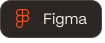
  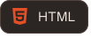
  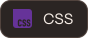
  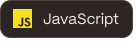
  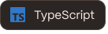
  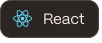
  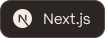
  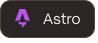
  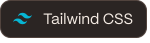
  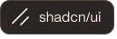
  
  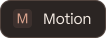
  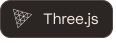
  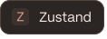
  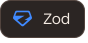
  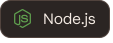
  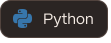
  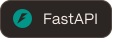
  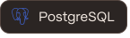
  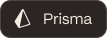
  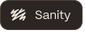
  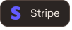
  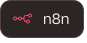
  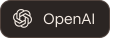
  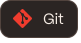
  
  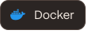
  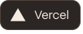
  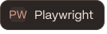

## <picture><source media="(prefers-color-scheme: light)" srcset="./assets/headings/ai-tools-light.svg"></picture>

  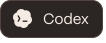
  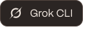
  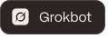
  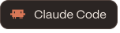

## <picture><source media="(prefers-color-scheme: light)" srcset="./assets/headings/capabilities-light.svg"></picture>

- **Workflow automation:** I automate processes with n8n, connect services through APIs and webhooks, and build practical AI integrations.
- **Payments & subscriptions:** I integrate Stripe for one-time payments, recurring subscriptions, and customer billing portals.

## <picture><source media="(prefers-color-scheme: light)" srcset="./assets/headings/connect-light.svg"></picture>

<a href="https://www.upwork.com/freelancers/~01648f1c04b49f406f"><picture><source media="(max-width: 600px)" srcset="./assets/contacts/upwork-mobile.svg" width="50%" height="100">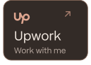</picture></a><a href="https://www.linkedin.com/in/danylo-zorkin-bb0bbb283/"><picture><source media="(max-width: 600px)" srcset="./assets/contacts/linkedin-mobile.svg" width="50%" height="100">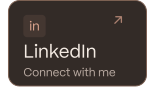</picture></a><a href="mailto:danilzorkin1402@gmail.com"><picture><source media="(max-width: 600px)" srcset="./assets/contacts/email-mobile.svg" width="50%" height="100"></picture></a><a href="https://t.me/danylo_zorkin"><picture><source media="(max-width: 600px)" srcset="./assets/contacts/telegram-mobile.svg" width="50%" height="100">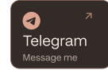</picture></a>

<picture>
  <source media="(max-width: 600px) and (prefers-reduced-motion: reduce)" srcset="./assets/skyline-mobile-static.svg?v=e3672f499a7b">
  <source media="(prefers-reduced-motion: reduce)" srcset="./assets/skyline-desktop-static.svg?v=e3672f499a7b">
  <source media="(max-width: 600px)" srcset="./assets/skyline-mobile.svg?v=e3672f499a7b">
  
</picture>
